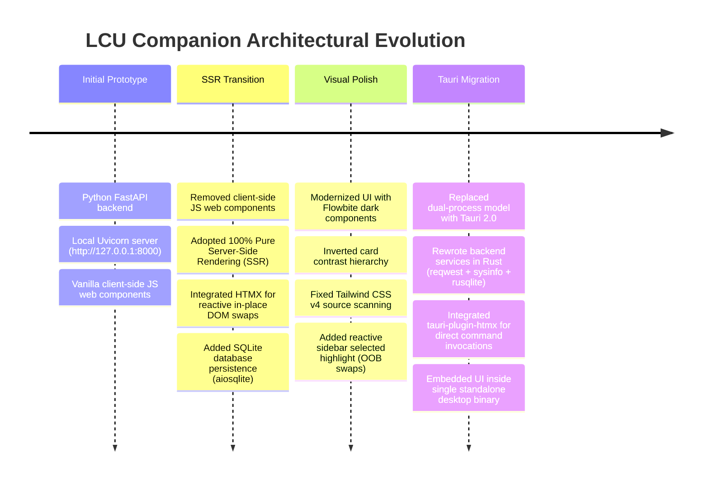

# Project Migration & Architectural Evolution

This document chronicles the evolution of **LCU Companion** from its initial Python FastAPI local server implementation to a native **Tauri 2.0 desktop application in Rust**, providing key context, architectural rationale, lessons learned, and tips for future LLM assistants.

---

## 1. Evolution Timeline



---

## 2. Why the Project Was Migrated to Tauri

1. **Elimination of Dual Processes & Runtime Dependencies**:
   - The FastAPI version required the end-user to manage Python environments (virtual environments/conda), run Uvicorn on localhost, and keep a browser tab open.
   - Tauri bundles the application into a single, lightweight native desktop binary with zero external Python runtime dependencies.
2. **Native Performance & Memory Footprint**:
   - Rust eliminates Python interpreter overhead, using asynchronous I/O (`tokio` and `reqwest`) and native `rusqlite` for blazing fast responses.
3. **Preservation of the Pure SSR + HTMX Philosophy**:
   - By using `tauri-plugin-htmx`, the frontend retains its clean, declarative HTML-only nature without needing React, Vue, or heavy client-side state management frameworks.

---

## 3. Core Architectural Decisions

### A. The HTMX-Tauri Bridge (`tauri-plugin-htmx`)
Instead of making HTTP `fetch` calls over localhost, HTMX's `XMLHttpRequest.send()` is patched by `tauri-plugin-htmx`. Attributes use the `command:` prefix:
```html
<button
  hx-get="command:ui_rune_tree_client"
  hx-vals='{"pageId": 54}'
  hx-target="#current-rune-tree-container"
  hx-swap="outerHTML"
>
```
When triggered, Tauri executes the Rust `#[tauri::command]` function directly, and HTMX receives the rendered HTML string to perform its standard DOM swap.

### B. Out-of-Band (OOB) Synchronized Updates
When viewing a rune page, the response returns the center tree HTML alongside an out-of-band swapped sidebar:
```html
<div id="current-rune-tree-container">...</div>
<div id="saved-runes-container" hx-swap-oob="outerHTML">...</div>
```
This simultaneously updates the center canvas and the sidebar's glowing selected highlight in a single round-trip without writing custom JavaScript.

### C. Self-Signed TLS & LCU Client Connection
The League client uses an internal self-signed HTTPS certificate. In Rust, `reqwest::ClientBuilder::danger_accept_invalid_certs(true)` is used with `Basic riot:<auth_token>` headers to communicate securely with the local client port.

### D. Process Discovery with `sysinfo`
Process arguments (`--app-port` and `--remoting-auth-token`) are extracted directly from `LeagueClientUx.exe` across Windows systems without relying on fragile shell scripts or external lockfiles.

---

## 4. Key Lessons & Tips for Future LLM Sessions

> [!IMPORTANT]
> **1. Package Management**: Always use `pnpm` for frontend package commands (`pnpm add ...`, `pnpm install`, `pnpm tauri dev`). Never use `npm`.

> [!TIP]
> **2. Tailwind CSS v4 Setup**: In Tailwind v4, styles must use `@import "tailwindcss";` and `@tailwindcss/vite`. Any HTML or Rust files containing class names must be within Vite's scan tree.

> [!NOTE]
> **3. Pure SSR / No Client JS**: Maintain the application's clean design philosophy: all UI updates and interactivity should be driven by server-side HTML rendering and HTMX attributes (`command:...`). Do not introduce client-side state stores or heavy framework scripts.

> [!TIP]
> **4. High-Signal Prompting**: When starting new tasks, consult [`CURRENT_STATE.md`](@docs/llm/gemini/CURRENT_STATE.md) and [`DOCS_LINKS.md`](@docs/llm/gemini/DOCS_LINKS.md) to instantly grasp current features and avoid redundant context reading.

> [!IMPORTANT]
> **5. Rust Raw String Literals with HTML Attributes**: In Rust, `r#"..."#` raw string literals will terminate prematurely if they contain `"#` (e.g. `hx-target="#app-shell"` or `id="#..."`). Always use `r##"..."##` (double hash delimiters) when writing HTML templates containing `#` attribute selectors in Rust.
