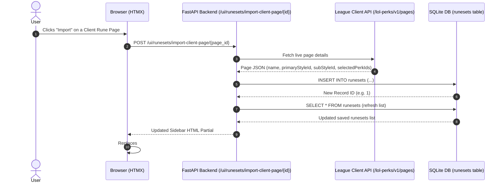

# Rune Importing & Database Integration

This document explains the end-to-end workflow for discovering, importing, storing, viewing, and deleting rune pages in LCU Companion.

---

## 1. Overview of the Dual-Section Model

The Runes interface maintains a clear separation between **live client pages** and **app-managed persistent pages**:

```
┌──────────────────────────────────────────────────────────────────────────┐
│                             Runes Interface                              │
├─────────────────────────────────────┬────────────────────────────────────┤
│           Left Sidebar              │            Center View             │
│                                     │                                    │
│  [League Client Pages]              │  [Active Rune Tree Canvas]         │
│  ├─ Precision: The Perfect [Active] │  ├─ Primary Tree (Domination)      │
│  │   └─ [Import Button]             │  │   ├─ Keystone (Electrocute)     │
│  └─ Domination: Dark Burst          │  │   └─ Tiers 1-3                  │
│      └─ [Import Button]             │  ├─ Secondary Tree (Precision)     │
│                                     │  │   └─ Active Tiers 1-2           │
│  [Companion Saved Runes (SQLite)]   │  └─ Stat Mods (3 Tiers)            │
│  ├─ Aatrox Top [Delete Button]      │                                    │
│  └─ Jinx Lethality [Delete Button]  │                                    │
└─────────────────────────────────────┴────────────────────────────────────┘
```

---

## 2. Discovery: Live League Client Pages

When the Runes tab loads:

1. HTMX triggers `GET /ui/runesets` on `#saved-runes-container`.
2. The server calls [`get_client_rune_pages()`](api/services/rune_tree.py#L223):
   - Connects to LCU via [`LcuApiClient`](api/services/lcu_api.py).
   - Requests `GET /lol-perks/v1/pages`.
   - Resolves the primary style icon and name from CDragon metadata.
3. The server queries SQLite via `RuneSetRepository.list_runesets()` to get companion saved pages.
4. Returns the combined HTML rendered by [`render_runes_sidebar`](api/web/templates.py#L114).

---

## 3. Importing Workflow (Client → SQLite)



### Steps in Detail:
1. **User Action**: Clicking the **"Import"** button sends an HTMX request:
   ```html
   <button
     hx-post="/ui/runesets/import-client-page/54"
     hx-target="#saved-runes-container"
     hx-swap="outerHTML"
   >
     Import
   </button>
   ```
2. **Backend Insertion**:
   [`ui_import_client_page`](api/main.py#L179) extracts the page's metadata and saves it:
   ```python
   await _rune_store.save_runeset(
       rune_page_name=target_page["name"],
       primary_style_id=target_page["primary_style_id"],
       sub_style_id=target_page["sub_style_id"],
       selected_perk_ids=target_page["selected_perk_ids"],
       rune_page_id=target_page["id"],
       source="league_client",
   )
   ```
3. **Reactive Update**: The endpoint returns the newly generated sidebar HTML, instantly displaying the imported page in the **Companion Saved Runes** section without a full page reload.

---

## 4. Viewing a Rune Page in the UI

Both Client pages and Saved pages can be clicked to load into the main canvas:

### A. Viewing a Client Page:
- **Trigger**: `hx-get="/ui/rune-tree/client/{page_id}"`
- **Target**: `hx-target="#current-rune-tree-container" hx-swap="outerHTML"`
- **Backend Flow**:
  1. [`ui_rune_tree_client`](api/main.py#L225) calls [`get_client_page_rune_tree_payload(page_id)`](api/services/rune_tree.py#L283).
  2. Resolves perk styles, icons, and stat mods against the CommunityDragon cache.
  3. Returns [`render_rune_tree(tree=...)`](api/web/templates.py#L258).

### B. Viewing a Companion Saved Page:
- **Trigger**: `hx-get="/ui/rune-tree/saved/{runeset_id}"`
- **Target**: `hx-target="#current-rune-tree-container" hx-swap="outerHTML"`
- **Backend Flow**:
  1. [`ui_rune_tree_saved`](api/main.py#L236) calls [`get_saved_runeset_tree_payload(runeset_id)`](api/services/rune_tree.py#L311).
  2. Queries SQLite for the saved `selected_perk_ids_json` and style IDs.
  3. Builds the normalized tree and returns [`render_rune_tree(tree=...)`](api/web/templates.py#L258).

---

## 5. Deleting a Companion Saved Page

- **Trigger**: `hx-delete="/ui/runesets/{runeset_id}"` with `hx-confirm="Delete saved rune page...?"`
- **Target**: `hx-target="#saved-runes-container" hx-swap="outerHTML"`
- **Backend Flow**:
  1. [`ui_delete_runeset`](api/main.py#L207) calls `RuneSetRepository.delete_runeset(runeset_id)`.
  2. Removes the record from SQLite.
  3. Re-renders and returns the updated sidebar.

---

## 6. Endpoints Summary

| Method | Path | Response | Purpose |
| :--- | :--- | :--- | :--- |
| `GET` | `/ui/runesets` | HTML | Renders full dual-section sidebar (Client + Saved). |
| `POST` | `/ui/runesets/import-client-page/{page_id}` | HTML | Imports client page to SQLite and returns updated sidebar. |
| `DELETE` | `/ui/runesets/{runeset_id}` | HTML | Deletes saved page from SQLite and returns updated sidebar. |
| `GET` | `/ui/rune-tree/current` | HTML | Renders current active client rune tree. |
| `GET` | `/ui/rune-tree/client/{page_id}` | HTML | Renders specific client rune page tree. |
| `GET` | `/ui/rune-tree/saved/{runeset_id}` | HTML | Renders specific SQLite saved rune page tree. |
