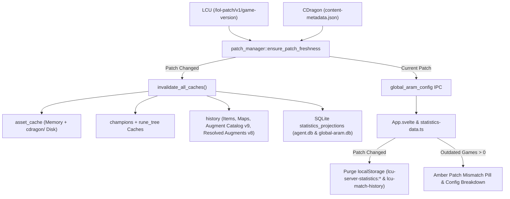

# Crawler Reset, Cross-Patch Warnings & Patch-Aware Auto-Updating Caches

## Overview

This update introduces three interconnected capabilities to handle major League of Legends & ARAM Mayhem updates seamlessly:

1. **Global Database & BFS Search Tree Reset UI**: Added a **Reset Database & Search Tree** action with inline confirmation inside the Crawler Config popover in [`App.svelte`](src/App.svelte).
2. **Cross-Patch Database Detection & Warnings**: Games stored in `global-aram.db` and `agent.db` now track `game_version` and normalized `patch` (`major.minor`), backfilling existing games automatically and surfacing an amber warning pill and per-patch breakdown when stored games come from older patches.
3. **Architecture-Wide Patch-Aware Cache Invalidation & Dynamic Augment/Map Resolution**: Added [`patch_manager.rs`](src-tauri/src/services/patch_manager.rs) to detect live patch changes from LCU or CommunityDragon and automatically invalidate all memory, disk, SQLite projection, and frontend `localStorage` caches, while dynamically resolving new ARAM Mayhem augments (`kiwi.bin.json` + `cherry-augments.json` + `lol.stringtable.json`) and maps (`maps.json`).

---

## Architecture & Data Flow

---

## Key Changes Made

### 1. Centralized Patch Manager & Auto-Updating Caches
- **[`patch_manager.rs`](src-tauri/src/services/patch_manager.rs)**:
  - Queries LCU (`/lol-patch/v1/game-version` or `/system/v1/builds`) with a fallback to CommunityDragon (`/latest/content-metadata.json`).
  - Normalizes version strings into `major.minor` (e.g. `"16.20"`) and persists `%LOCALAPPDATA%\lcu-companion\cache\cache_metadata.json`.
  - When a patch transition is detected, triggers `invalidate_all_caches()` across all backend services.
- **[`asset_cache.rs`](src-tauri/src/services/asset_cache.rs)**:
  - Added [`invalidate_asset_cache`](src-tauri/src/services/asset_cache.rs#L112-L125) to clear `ASSET_MEMORY_CACHE` and delete cached CDragon files on disk (`cache/cdragon/`).
- **[`champions.rs`](src-tauri/src/services/champions.rs), [`rune_tree.rs`](src-tauri/src/services/rune_tree.rs), & [`coachless.rs`](src-tauri/src/services/rune_stats/coachless.rs)**:
  - Hooked `ensure_patch_freshness` into CDragon champion and perk fetches, and replaced the hardcoded `(16, 16)` fallback in `coachless.rs` with `patch_manager::get_cached_patch_numbers()`.
- **[`history.rs`](src-tauri/src/services/history.rs) & [`models/history.rs`](src-tauri/src/models/history.rs)**:
  - Ported dynamic CommunityDragon augment tooltip & math formula resolution (`kiwi.bin.json` + `cherry-augments.json` + `lol.stringtable.json`) directly into Rust (`get_augment_catalog_map`), caching per patch to `augment_catalog_v9.json` and falling back to bundled `augment_tooltips.json` only if offline.
  - Prevented unresolved fallback augments (`icon_url.is_empty() && rarity.is_none()`) from being permanently written to `augments_v8.json`.
  - Added dynamic map resolution from CDragon `maps.json` (`MAPS_CACHE`) and exposed `map_name` and `patch` on [`MatchHistoryItem`](src-tauri/src/models/history.rs#L19-L41).

### 2. Agent Database Patch Tracking & Crawler Reset
- **[`agent/mod.rs`](src-tauri/src/agent/mod.rs)**:
  - Added `game_version TEXT` and `patch TEXT` columns to `aram_games` in `global-aram.db` and `games` in `agent.db`.
  - Added [`backfill_global_game_patches`](src-tauri/src/agent/mod.rs#L1439-L1501) to extract `gameVersion` from existing `aram_games.detail_json` records on startup.
  - Updated [`store_global_detail`](src-tauri/src/agent/mod.rs#L2569-L2625) and [`store_recent_games`](src-tauri/src/agent/mod.rs#L2231-L2289) to persist `game_version` and `patch` on every new game.
  - Restricted [`run_global_aram_worker`](src-tauri/src/agent/mod.rs#L3057-L3295) and [`store_global_detail`](src-tauri/src/agent/mod.rs#L2569-L2590) to **only collect and store games matching the current patch** (`is_game_summary_on_patch` & `is_game_detail_on_patch`), breaking out of an account's reverse-chronological match list as soon as an older-patch game is encountered (with a participant-only bootstrap seed if the initial account has no current-patch games yet).
  - Extended `"global_aram_config"` with `current_patch`, `patches` breakdown, `outdated_games`, and `has_patch_mismatch`.
  - Added `"reset_global_aram"` command and `CRAWLER_GENERATION` atomic counter to immediately stop in-flight crawler workers, wipe `aram_games`, `aram_participants`, `discovered_accounts`, and `statistics_projections`, checkpoint the WAL file, re-seed `discovered_accounts` with the current summoner PUUID, and wake the collector loop.
  - Upgraded [`AdaptiveRateLimiter`](src-tauri/src/agent/mod.rs#L2753-L2906) and [`CrawlerCircuitBreaker`](src-tauri/src/agent/mod.rs#L2981-L3099):
    - **In-flight wave deduplication**: Requests are tagged with `request_started_at` (`pace_next_tagged`). If a sibling worker's request was already in flight before a backoff or cooldown began (`request_started_at <= last_backoff_at` or `is_in_cooldown().is_some()`), its failure joins the existing cooldown (`CooldownOutcome::JoinedExisting`) instead of counting as a new consecutive error and doubling the backoff timer (`60s -> 120s -> 240s`) within seconds.
    - **Ceiling discovery & locking**: When a route backs off, `AdaptiveRateLimiter` computes a safe sustainable ceiling (`80%–85%` of the choke RPM), steps up cautiously (`+1 RPM`) back to that ceiling, and **locks onto the learned ceiling** instead of endlessly ramping up into another timeout.
    - **Per-route SQLite rate-limit caching**: Separated rate limiters for `/lol-match-history/v1/products/lol/{puuid}/matches` (`matches`) and `/lol-match-history/v1/games/{game_id}` (`games`), persisting `rate_limit_{route}_rpm` and `rate_limit_{route}_ceiling_rpm` in `global-aram.db`'s `config` table across runs and resets.
- **[`commands/agent.rs`](src-tauri/src/commands/agent.rs) & [`lib.rs`](src-tauri/src/lib.rs)**:
  - Exposed and registered the `api_reset_global_aram` Tauri command.

### 3. Frontend UI Controls, Patch Warnings & Cache Sync
- **[`src/lib/api/agent.ts`](src/lib/api/agent.ts) & [`src/lib/utils/statistics-data.ts`](src/lib/utils/statistics-data.ts)**:
  - Added `resetGlobalAramDatabase()`, `clearStatisticsCache()`, and `syncStatisticsCachePatch(patch)` to automatically purge `lcu-server-statistics:*` and `lcu-match-history` in `localStorage` when the game patch changes.
- **[`src/App.svelte`](src/App.svelte)**:
  - Added an amber **Outdated patch data** warning button in the Statistics header bar and an indicator badge on the Crawler Config cog button whenever `globalHasPatchMismatch` is true.
  - Added a detailed per-patch breakdown banner and the **Reset Database & Search Tree** button (with inline `Confirm Reset` / `Cancel` confirmation) inside the Crawler Config popover.
- **[`MatchHistoryView.svelte`](src/lib/components/history/MatchHistoryView.svelte), [`BuildStatisticsView.svelte`](src/lib/components/history/BuildStatisticsView.svelte), & [`ProfileStatisticsView.svelte`](src/lib/components/history/ProfileStatisticsView.svelte)**:
  - Updated `MatchHistoryView.svelte` to display dynamic map names (`match.map_name`) and game patch (`v{match.patch}`).
  - Connected `refreshKey` to `BuildStatisticsView` and `ProfileStatisticsView` so resetting the database or transitioning patches immediately forces a fresh statistics reload.

