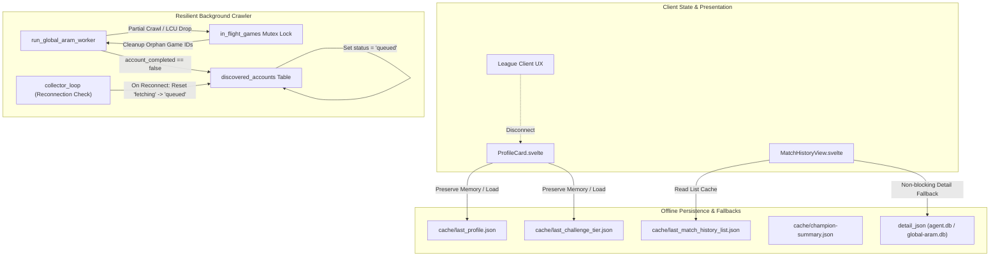

# Offline Mode and Graceful Recovery Walkthrough

## 1. Overview and Problem Statement

When the League Client (LCU) closed or disconnected mid-session, the companion app previously exhibited severe failure modes:
- **UI State Loss**: Closing the client wiped the summoner profile, challenge tier, and match history views, replacing loaded data with empty/error screens.
- **Champion Catalog Failures**: Network failures during CDragon lookups stopped champion summary catalog loading entirely without disk recovery.
- **Mid-Crawl Data Invalidation & Worker Block**: LCU disconnections during global ARAM crawl operations caused in-flight accounts to be marked as permanently `failed`, lost crawler progress, and left orphan match IDs in concurrency locks.

This architecture update implements offline persistence layers, non-blocking disk and SQLite fallbacks, graceful recovery loops, and resilient crawler account re-queueing.

---

## 2. Architecture & Key Changes

### A. Offline Profile & Challenge Tier (`services/summoner.rs` + `ProfileCard.svelte`)
- **Persistent Disk Cache**:
  - `services/summoner.rs` caches successful profile payloads to `%LOCALAPPDATA%\lcu-companion\cache\last_profile.json`.
  - Challenge tier details persist to `%LOCALAPPDATA%\lcu-companion\cache\last_challenge_tier.json`.
  - When LCU is unreachable or offline, `get_current_summoner()` transparently falls back to reading `last_profile.json`.
- **In-Memory UI State Retention**:
  - `ProfileCard.svelte` maintains in-memory profile state on `lcu:disconnected` events rather than clearing state to `null`.
  - Displays a subtle `"Offline"` badge indicator while keeping summoner name, level, profile icon, and ranked/challenge borders visible.

### B. Offline Match History (`services/history.rs` + `MatchHistoryView.svelte`)
- **Persistent List Cache**:
  - Successful match history list fetches write out to `cache/last_match_history_list.json`.
  - When LCU connection fails, `get_match_history()` falls back to `last_match_history_list.json`.
- **Non-Blocking Detail Fallbacks (`read_detail_cache`)**:
  - Match details first check local memory and disk caches before checking SQLite (`agent.db` and `global-aram.db`).
  - Cached game details populate match rows even when the client is disconnected.
- **Frontend Offline Notice**:
  - `MatchHistoryView.svelte` renders an amber alert banner when viewing cached data:
    `"League Client offline — displaying cached match history"`.

### C. Static Champion Catalog Cache (`services/champions.rs`)
- **Disk Fallback**:
  - Remote CDragon `champion-summary.json` is verified and persisted to `cache/champion-summary.json`.
  - Schema validation ensures corrupt downloads or HTML error responses are not persisted to disk.
  - If CDragon or local network requests fail, service automatically parses the verified disk copy to supply champion definitions.

### D. Mid-Processing Disconnection Recovery (`agent/mod.rs`)
- **Account Re-Queueing vs Permanent Failure**:
  - `run_global_aram_worker` avoids marking accounts as `failed` when an LCU connection drop occurs.
  - Partial crawls set `account_completed = false`, causing the account state to finalize as `status = 'queued'` instead of `complete` or `failed`.
- **Safe Early Termination & Concurrency Lock Release**:
  - `in_flight_games: Arc<tokio::sync::Mutex<HashSet<i64>>>` tracking ensures games in progress are cleaned up immediately if worker encounters disconnect or backoff, preventing orphaned locks.
- **Collector Reconnection Sweep**:
  - When `collector_loop` detects client reconnection, it executes a recovery query updating orphan accounts from `status = 'fetching'` back to `status = 'queued'`.

### E. Thread Safety and SQLite Compliance
- All database operations in async agent contexts use `tokio::task::spawn_blocking`.
- SQLite connections maintain WAL mode with a 5-second busy timeout to prevent database lockups under high crawler concurrency.

---

## 3. Files Touched

| File | Subsystem | Modifications |
|---|---|---|
| `src-tauri/src/services/summoner.rs` | Profile Service | Added `last_profile.json` & `last_challenge_tier.json` disk fallback. |
| `src/lib/components/ProfileCard.svelte` | Presentation | Retained profile state on disconnect, added subtle offline status badge. |
| `src-tauri/src/services/history.rs` | Match History | Added `last_match_history_list.json` caching and non-blocking `read_detail_cache`. |
| `src/lib/components/history/MatchHistoryView.svelte` | Presentation | Added `"League Client offline — displaying cached match history"` warning. |
| `src-tauri/src/services/champions.rs` | Champions Catalog | Added schema-validated `champion-summary.json` disk fallback. |
| `src-tauri/src/agent/mod.rs` | Crawler / Agent | Implemented `account_completed` re-queuing, `in_flight_games` lock cleanup, and orphan reset on reconnect. |

---

## 4. Validation & Verification

1. **LCU Disconnection Simulation**:
   - Closed League Client while actively viewing Profile & Match History. Verified profiles and match lists remained visible with offline indicators.
2. **Crawler Disconnection Recovery**:
   - Terminated League Client while global ARAM crawler had accounts in `fetching` status. Verified crawler paused gracefully, unlocked games, re-queued accounts (`queued`), and resumed upon client reconnect.
3. **Champion Catalog Offline Load**:
   - Blocked external CDragon network requests; verified champion metadata loaded from `cache/champion-summary.json`.

---

## 5. Next Steps

- **Stale Cache Indicator**: Add optional last-synced timestamp to profile and match history views when loaded from disk.
- **Selective Background Retry**: Allow manual trigger to force-revalidate cached profile without full page reload.
