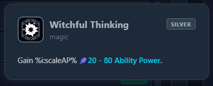
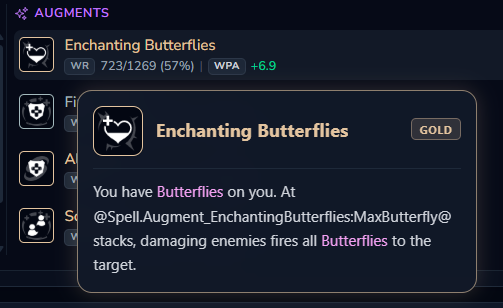
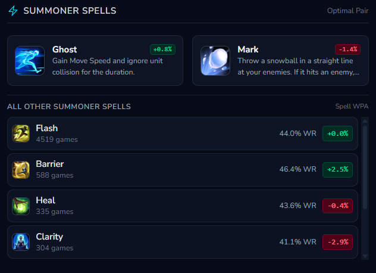

# version 0.2.0

much has been done recently in the LCU Companion application.
start by committing all your changes and pushing it to the origin.

### features to implement / bugs to fix

1.  the status of the champion selector inside aram mayhem / champion selection should be synchronized with that of the selector on the top bar off the application, together with its selection cache (remembering last selected champion in the last sessions + showing the selected champion's icon first in the list).
2.  mayhem \> statistics
    1.  poro-snax is still showing in mayhem \> statistics \> associated items.
    2.  associated items inside mayhem \> statistics should contain a selector for most picked/highest win-rate/highest WPA. Same with associated augments.
    3.  items and augments in the "associated" sections should have tooltips as well, like what happens in other sections of the application.
    4.  add more items and augments to the associated item/augments (currently its 8, lets try with 15)
3.  starter items can be not necessary. some builds have recommended starter items with \~0% pick rate.
4.  some item and augment tooltips are being rendered as unparsed templates:
    1.  ref 3.1
        
    2.  ref 3.2
        
5.  summoner spell algorithm might be incorrect or incomplete, take Ashe as an example, here are her summoner spell information:
    1.  ref 4
        
6.  global-aram crawler:
    1.  add an ETA to the crawler status, together with the % and match/time indicator, at the right of both.
    2.  updates are only being shown inside Mayhem \> Statistics. the component needs to be shown globally in all pages of the application, including other tabs such as Builds and Profile, within all their respective inner tabs. This due to the indicator providing to the user the information that their client is being used to request information to the LCU, which should be a state displayed to the user at all times.
    3.  the configuration button inside Mayhem \> Statistics should instead be displayed on the title bar at the right, right before the window controls, with its styling being on part with the rest of its parent component: transparent background with no button container (no border, no bg, little padding), with the icon itself being the button and only changing background color upon hovering (such as the tab selectors and the window controls - the other title bar components)
        - the pulsing icon showing Active Operations should also be moved to the title bar, with its container (border and background color for container) being removed, and only the pulsing dot indicator being present. hovering it still provides information about active operations.
    4.  the configuration should display a button to stop/pause the worker.
        1.  stopping marks its current crawling as completed, removing the upper limit left. starting the crawler again requires the user to set a higher upper limit for matches.
        2.  pausing the worker maintains the upper limit for games crawled, but sets the crawler as inactive, unpausing resumes activity as normal.
7.  add, in-between the active operations indicator and the configuration button, a new tab called logs. it should display all past logs saved by the application sorted by datetime, while also presenting to the user the real-time logs of this instance of the application
8.  tray icon menu:
    1.  update "Show LCU Companion" to "Hide LCU Companion" when the window is open.
    2.  add an unclickable row displaying crawler/active operations information.
