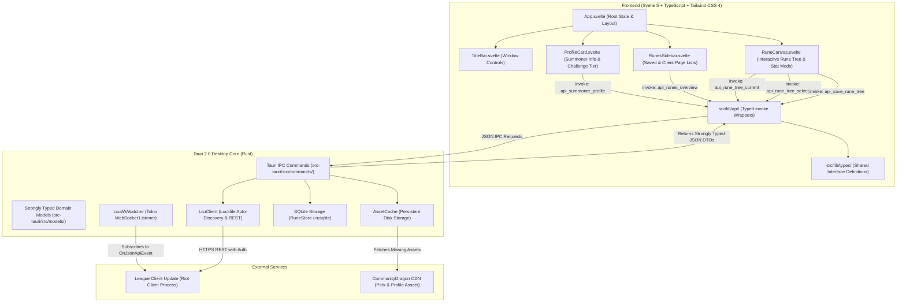

# LCU Companion — Project Architecture & Developer Guide

**LCU Companion** is a high-performance, low-latency desktop application designed for League of Legends players. It connects directly with the Riot Games League Client Update (LCU) to provide real-time rune page synchronization, interactive rune page editing, persistent custom runeset storage, and one-click in-game exporting.

> [!NOTE]
> **Architecture Evolution**: The project originally used Server-Side Rendered (SSR) HTML string concatenation in Rust with HTMX 2.0 swaps. It has since been migrated to a modern **Svelte 5 (Runes) + TypeScript** frontend powered by strongly typed **Tauri 2.0 JSON IPC commands**, completely eliminating backend HTML string generation.

---

## 1. High-Level Architecture

The application adopts a **Client-Rendered Reactive Architecture** embedded inside a native **Tauri 2.0** desktop container. The frontend is built with **Svelte 5** and **TypeScript**, styled via **Tailwind CSS 4.0**, and communicates with the native Rust backend exclusively through typed asynchronous Tauri IPC commands (`invoke("api_*")`).



---

## 2. Core Technology Stack

| Technology | Role & Purpose | Documentation & References |
| :--- | :--- | :--- |
| **Tauri 2.0** | Native cross-platform desktop framework powering window management, native IPC, and system integration. | [Tauri Documentation](https://v2.tauri.app/) · [`@llm/docs/ui/tauri.llms.txt`](/@llm/docs/ui/tauri.llms.txt) |
| **Svelte 5** | Reactive UI framework using modern runes (`$state`, `$derived`, `$props`, `$effect`) for performant and expressive component state. | [Svelte Documentation](https://svelte.dev/) · [`@llm/docs/context/HTMX_TO_SVELTE.md`](/@llm/docs/context/HTMX_TO_SVELTE.md) |
| **TypeScript** | Strict type safety for all frontend components, domain models, and API client invoke functions. | [TypeScript Docs](https://www.typescriptlang.org/) |
| **Rust (2021)** | Backend language providing memory safety, high throughput, low latency, and minimal footprint. | [Rust Standard Library](https://doc.rust-lang.org/std/) · [Tokio Async Runtime](https://tokio.rs/) |
| **Tailwind CSS 4.0** | Utility-first CSS framework providing dark-themed styling, smooth transitions, and thematic rune path colors. | [Tailwind CSS Docs](https://tailwindcss.com/docs) · [`@llm/docs/ui/THEME.md`](/@llm/docs/ui/THEME.md) |
| **Flowbite** | Component library system providing UI design patterns, button variants, badges, and modals. | [`@llm/docs/ui/flowbite/`](/@llm/docs/ui/flowbite/) · [Flowbite Docs](https://flowbite.com/) |
| **Svelte Motion** | Framer Motion-compatible declarative animation library (`@humanspeak/svelte-motion`) for layout and UI transitions. | [`@llm/docs/ui/motion_svelte.llm.txt`](/@llm/docs/ui/motion_svelte.llm.txt) · [Svelte Motion Docs](https://motion.svelte.page/) |
| **SQLite (rusqlite)** | Embedded zero-configuration SQL database for persisting saved rune pages and user preferences. | [`@llm/docs/db/DATABASE.md`](/@llm/docs/db/DATABASE.md) · [rusqlite Docs](https://docs.rs/rusqlite/) |
| **League Client Update (LCU)** | Riot Games local client REST API and WebSocket (`127.0.0.1:<port>`) authenticated via lockfile. | [`@llm/docs/lcu/LCU.md`](/@llm/docs/lcu/LCU.md) · [`@llm/docs/lcu/swagger.json`](/@llm/docs/lcu/swagger.json) |
| **CommunityDragon (CDragon)** | CDN source for perk icons, challenge rank tokens, summoner borders, and static metadata. | [CommunityDragon Docs](https://communitydragon.org/) · [`@llm/docs/lcu/cdragon_perk_styles_index.html`](/@llm/docs/lcu/cdragon_perk_styles_index.html) |

---

## 3. Project Directory Map

```text
lcu-companion/
├── @llm/                               # Complete project documentation and context
│   └── docs/
│       ├── context/                    # Architecture, live state, and migration notes
│       ├── db/                         # SQLite schema, queries, and rune domain models
│       ├── historical/                 # Shelved features (Tools/Friend cleaner) & logs
│       ├── lcu/                        # LCU REST/WebSocket specs & OpenAPI swagger.json
│       └── ui/                         # Design system, thematic colors, and cheat sheets
├── src/                                # Svelte 5 + TypeScript Frontend Application
│   ├── lib/
│   │   ├── api/                        # Typed Tauri IPC client wrappers
│   │   │   ├── client.ts               # Generic invoke wrapper with logging
│   │   │   ├── profile.ts              # Summoner & ch│   │   ├── components/                 # Reactive UI Components
│   │   │   ├── ChampionSelectModal.svelte # Flowbite modal for picking rune page champion
│   │   │   ├── Divider.svelte          # Animated divider component
│   │   │   ├── ProfileCard.svelte      # Summoner profile card & challenge badge
│   │   │   ├── TitleBar.svelte         # Window title bar with drag region & controls
│   │   │   ├── runes/                  # Center canvas rune tree components
│   │   │   │   ├── KeystoneCard.svelte # Large keystone card with telemetry
│   │   │   │   ├── KeystonesRow.svelte # Dynamic column keystone options row
│   │   │   │   ├── PerkTierList.svelte # 3 primary tier rows with authentic names
│   │   │   │   ├── PrimaryPathCard.svelte # Primary tree card container
│   │   │   │   ├── PrimaryStyleSelector.svelte # 5 primary style buttons row
│   │   │   │   ├── RuneCanvas.svelte   # Center canvas top-level data orchestrator
│   │   │   │   ├── RuneCanvasHeader.svelte # Title, avatar, action buttons & filter tray
│   │   │   │   ├── RuneCard.svelte     # Perk card with selection badge & telemetry
│   │   │   │   ├── RuneFilterTray.svelte # Role & rank filter tray with animation
│   │   │   │   ├── RuneLoadingSkeleton.svelte # Animated telemetry loading skeleton
│   │   │   │   ├── SecondaryPathCard.svelte # Secondary tree & shards container
│   │   │   │   ├── SecondaryStyleSelector.svelte # 4 secondary style buttons with pick rate
│   │   │   │   ├── SecondaryTierList.svelte # 3 secondary tier rows
│   │   │   │   ├── StatShardsCards.svelte # Offense, flex, & defense stat shards
│   │   │   │   └── TelemetryStats.svelte # Reusable pick rate + bidirectional WPA bar
│   │   │   └── sidebar/                # Dual list sidebar components
│   │   │       ├── ChampionCarousel.svelte # Scrollable horizontal champions carousel
│   │   │       ├── ChampionFilterSection.svelte # Champion search input + carousel
│   │   │       ├── ClientRuneItem.svelte # Individual live client page card
│   │   │       ├── ClientRunesList.svelte # Live client rune pages list
│   │   │       ├── RunesSidebar.svelte # Main sidebar layout orchestrator
│   │   │       ├── SavedRuneItem.svelte # Individual saved runeset card
│   │   │       ├── SavedRunesList.svelte # Companion saved library list
│   │   │       ├── SelectedChampionSlot.svelte # Dedicated pinned active champion slot
│   │   │       └── SidebarSkeleton.svelte # Sidebar loading pulse placeholder”‚   │   │   │   └── SavedRunesList.svelte  # Companion saved library with delete action
│   │   │   ├── ProfileCard.svelte      # Summoner profile card & challenge badge
│   │   │   └── TitleBar.svelte         # Window title bar with drag region & controls
│   │   ├── types/                      # Frontend TypeScript interface definitions
│   │   │   ├── profile.ts              # SummonerProfile & ChallengeTierProfile
│   │   │   └── runes.ts                # RuneTreePayload, RuneOption, RunesOverview, etc.
│   │   └── utils/                      # Utilities & Theme definitions
│   │       └── theme.ts                # Thematic path colors (Precision, Domination, etc.)
│   ├── App.svelte                      # Root application component
│   ├── main.ts                         # Application entrypoint mounting Svelte App
│   ├── styles.css                      # Tailwind CSS root imports and custom scrollbar
│   └── vite-env.d.ts                   # Vite environment typings
├── src-tauri/                          # Rust Backend Core
│   ├── src/
│   │   ├── commands/                   # Typed Tauri IPC command endpoints
│   │   │   ├── friends.rs              # Shelved mass friend removal command
│   │   │   ├── mod.rs                  # Commands module exports
│   │   │   ├── profile.rs              # Profile card & challenge tier endpoints
│   │   │   ├── runes.rs                # Rune tree, overview, import, export, save endpoints
│   │   │   └── summoner.rs             # Summoner profile REST endpoints
│   │   ├── models/                     # Strongly typed Rust domain models
│   │   │   ├── database.rs             # SQLite entity models
│   │   │   ├── lcu.rs                  # LCU API request/response structures
│   │   │   ├── mod.rs                  # Models module exports
│   │   │   └── runes.rs                # RuneTreePayload, RuneSlot, RunesOverviewPayload, etc.
│   │   ├── services/                   # Background services & business logic
│   │   │   ├── asset_cache.rs          # Disk caching for CDragon/DDragon icons
│   │   │   ├── db.rs                   # SQLite database connection & schema initialization
│   │   │   ├── friends.rs              # LCU chat/friends service
│   │   │   ├── lcu_client.rs           # Process/lockfile discovery & HTTPS client
│   │   │   ├── lcu_perks.rs            # Rune page synchronization & export logic
│   │   │   ├── lcu_websocket.rs        # Tokio WebSocket listener & real-time watcher
│   │   │   ├── mod.rs                  # Services module exports
│   │   │   ├── rune_store.rs           # SQLite CRUD repository for custom runesets
│   │   │   ├── rune_tree.rs            # Rune tree payload builder & CDragon perk loader
│   │   │   └── summoner.rs             # Summoner profile & challenge tier fetcher
│   │   ├── lib.rs                      # Tauri setup, command registration, and entrypoint
│   │   └── main.rs                     # Windows native entry point
│   ├── build.rs                        # Tauri build script
│   ├── Cargo.toml                      # Rust dependencies & optimization profiles
│   └── tauri.conf.json                 # Tauri configuration, window dimensions, and permissions
├── index.html                          # Initial HTML entry mounting `<div id="app"></div>`
├── package.json                        # Node dependencies (Svelte 5, Vite, Tailwind CSS, TypeScript)
├── svelte.config.js                    # Svelte compiler configuration with vitePreprocess
├── tsconfig.json                       # TypeScript compiler configuration
├── vite.config.ts                      # Vite build configuration with Svelte & Tailwind plugins
├── run.llm.ps1                         # PowerShell full-suite validation script
├── run.llm.sh                          # Bash full-suite validation script
└── GEMINI.md                           # Master project documentation (this file)
```

---

## 4. Subsystem Deep-Dives

### A. LCU Auto-Discovery & Real-Time Synchronization
1. **Lockfile Discovery**: [`services/lcu_client.rs`](/src-tauri/src/services/lcu_client.rs) inspects the Windows process list (`sysinfo`) for `LeagueClientUx.exe`, extracts `--app-port` and `--remoting-auth-token`, and reads the active `lockfile`.
2. **WebSocket Watcher**: [`services/lcu_websocket.rs`](/src-tauri/src/services/lcu_websocket.rs) establishes a background WSS connection to `127.0.0.1:<port>`, subscribes to `OnJsonApiEvent`, and actively triggers updates when the player switches rune pages or enters Champion Select.
3. **Companion Slot (`LCUC`)**: Exported runes are marked with the prefix `[LCUC]` and automatically synced to the active client slot.

### B. Persistent In-Disk Asset Caching
To ensure instant loading and offline capability:
- [`services/asset_cache.rs`](/src-tauri/src/services/asset_cache.rs) caches remote CDragon assets to disk under `%APPDATA%/com.eurmn.lcu-companion/cache/`.
- Assets include:
  - Rune Perk Icons (`/latest/plugins/rcp-be-lol-game-data/global/default/v1/perk-images/...`)
  - Summoner Profile Icons (`/latest/plugins/rcp-be-lol-game-data/global/default/v1/profile-icons/...`)
  - Ranked Borders (`/plugins/rcp-fe-lol-static-assets/global/default/images/ranked-emblems/...`)
  - Challenge Rank Tokens (`/latest/plugins/rcp-fe-lol-static-assets/global/default/challenges-shared/icon-token-(rank).png`)
- The backend serves local cached assets directly as local file URIs or base64 streams to the Svelte components.

### C. Thematic Rune UI System
The visual styling conforms to official League of Legends style paths via [`src/lib/utils/theme.ts`](/src/lib/utils/theme.ts):
- **Precision (ID: 8000)**: Amber / Gold (`border-yellow-500`, `text-yellow-400`, amber glow)
- **Domination (ID: 8100)**: Crimson / Red (`border-red-500`, `text-red-400`, crimson glow)
- **Sorcery (ID: 8200)**: Brand Purple (`border-purple-500`, `text-purple-400`, purple glow)
- **Inspiration (ID: 8300)**: Turquoise / Cyan (`border-cyan-400`, `text-cyan-400`, cyan glow)
- **Resolve (ID: 8400)**: Emerald / Green (`border-emerald-500`, `text-emerald-400`, emerald glow)

### D. SQLite Rune Library
Custom runesets are persisted in local SQLite via [`services/rune_store.rs`](/src-tauri/src/services/rune_store.rs):
- Table `runesets`: `id`, `name`, `primary_style_id`, `sub_style_id`, `selected_perk_ids` (JSON), `created_at`, `updated_at`.
- Table `favorite_champions`: `champion_id`, `created_at`.
- Provides instant importing from the live League client into the saved database and exporting back to the client.

### E. Flowbite Component System
The application's design language and UI primitives (buttons, modals, input groups, badges, tabs, alerts) are based on the **Flowbite** component system. Full component reference documentation is available under [`@llm/docs/ui/flowbite/`](/@llm/docs/ui/flowbite/):
- **Buttons & Actions**: Standardizes primary brand buttons, solid dark buttons, ghost buttons, gradient monochrome/duotones, and sizing.
- **Modals & Overlays**: Champion selection and dialog overlays built using Flowbite modal layout and backdrop standards.
- **Form Controls & Search**: Input boxes, search fields with leading icons, dropdowns, and pill filters.

### F. Heroicons Icon System
All icons across frontend Svelte components must use `@iconify-json/heroicons` (or `@iconify-json/flowbite` where specified) icon classes (e.g. `<span class="icon-[heroicons--...]"></span>` or `<span class="icon-[flowbite--...]"></span>`) rather than raw inline `<svg>` elements. Common icons include:
- Search: `icon-[heroicons--magnifying-glass]`
- Star / Favorite: `icon-[heroicons--star]` (outline) / `icon-[heroicons--star-solid]` (solid filled)
- Close / Remove: `icon-[heroicons--x-mark]`
- Edit: `icon-[heroicons--pencil-square]` / `icon-[heroicons--pencil-square-16-solid]`
- Save: `icon-[flowbite--floppy-disk-solid]` / `icon-[heroicons--check]`
- Lightning / Actions: `icon-[heroicons--bolt-16-solid]`
- Trash / Delete: `icon-[heroicons--trash]`
- Navigation: `icon-[heroicons--chevron-left]`, `icon-[heroicons--chevron-right]`
- Bookmark / Favorite: `icon-[heroicons--bookmark]` (outline) / `icon-[heroicons--bookmark-20-solid]` (solid filled)

---

## 5. Comprehensive Documentation Index (`@llm/docs/`)

For detailed specifications and domain knowledge, consult the specialized documents in [`@llm/docs/`](/@llm/docs/):

* **Context & Live State**:
  * [`CONTEXT.md`](/@llm/docs/context/CONTEXT.md) — System overview, data flows, and module responsibilities.
  * [`CURRENT_STATE.md`](/@llm/docs/context/CURRENT_STATE.md) — Live snapshot of registered commands, services, and test status.
  * [`HTMX_TO_SVELTE.md`](/@llm/docs/context/HTMX_TO_SVELTE.md) — Svelte 5 + TypeScript migration plan and architecture reference.
  * [`MIGRATION.md`](/@llm/docs/context/MIGRATION.md) — Architecture migration history.
  * [`DOCS_LINKS.md`](/@llm/docs/context/DOCS_LINKS.md) — Manifest of all documentation files.

* **League Client Integration**:
  * [`LCU.md`](/@llm/docs/lcu/LCU.md) — LCU protocol, auth headers, and WebSocket event handling.
  * [`swagger.json`](/@llm/docs/lcu/swagger.json) — Full OpenAPI specification for LCU endpoints.
  * [`getting-started-with-the-lcu-api`](/@llm/docs/lcu/getting-started-with-the-lcu-api) — LCU REST integration fundamentals.
  * [`getting-started-with-the-lcu-websocket`](/@llm/docs/lcu/getting-started-with-the-lcu-websocket) — LCU WebSocket event subscription guide.

* **Database & Domain Models**:
  * [`DATABASE.md`](/@llm/docs/db/DATABASE.md) — SQLite schema, indexes, and queries.
  * [`RUNES.md`](/@llm/docs/db/RUNES.md) — Rune perk IDs, style trees, and serialization formats.

* **UI, Animation & Theming**:
  * [`UI.md`](/@llm/docs/ui/UI.md) — UI architecture, Svelte 5 component hierarchy, Flowbite patterns, and Svelte Motion design.
  * [`flowbite/`](/@llm/docs/ui/flowbite/) — Flowbite component guides (buttons, forms, modals, alerts, badges, tables, etc.).
  * [`motion_svelte.llm.txt`](/@llm/docs/ui/motion_svelte.llm.txt) — Svelte Motion (`@humanspeak/svelte-motion`) declarative animation guide and cheat sheet.
  * [`THEME.md`](/@llm/docs/ui/THEME.md) — Thematic color palette rules for rune paths and Flowbite button styling tokens.
  * [`RUNE_TREE_PLAN.md`](/@llm/docs/ui/RUNE_TREE_PLAN.md) — Center canvas layout plan and sizing.
  * [`tauri.llms.txt`](/@llm/docs/ui/tauri.llms.txt) — Tauri 2.0 API reference cheat sheet.

* **Historical Archive**:
  * [`walkthrough/`](/@llm/docs/historical/walkthrough/) — Permanent archival walkthroughs for completed features and plans.
  * [`TOOLS_FEATURE_ARCHIVE.md`](/@llm/docs/historical/TOOLS_FEATURE_ARCHIVE.md) — Archival notes on the mass friend removal tool and top navigation header.

---

## 6. Development & Validation Workflow

### Running Locally
```powershell
# Start frontend and Tauri in development mode
pnpm tauri dev
```

### Full Validation Suite
The project includes automated verification scripts that execute `svelte-check`, `vite build`, `cargo check`, and `cargo test`:

* **Windows (PowerShell)**:
  ```powershell
  powershell -ExecutionPolicy Bypass -File .\run.llm.ps1
  ```
* **Unix / Linux / macOS (Bash)**:
  ```bash
  bash ./run.llm.sh
  ```

### Planning & Walkthrough Persistence
- **Walkthrough Archival**: Whenever completing work in Planning Mode, in addition to generating the session walkthrough artifact, **ALWAYS save a permanent copy of the walkthrough document inside `@llm/docs/historical/walkthrough/<feature_name>_walkthrough.md`** so historical implementation context is permanently tracked across sessions.

### Command Execution Guidelines
- **No Unsolicited Checks or Tests**: **DO NOT** run check, build, or test commands (such as `cargo check`, `cargo test`, `svelte-check`, `vite build`, `run.llm.ps1`, etc.) without the user's direct and explicit request.
